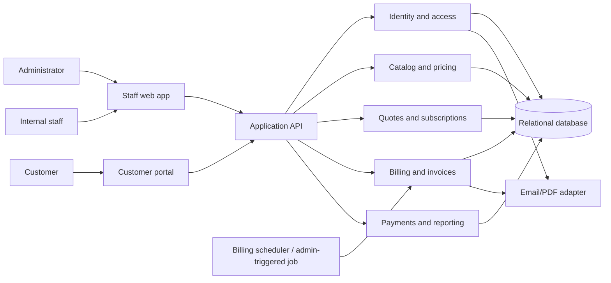
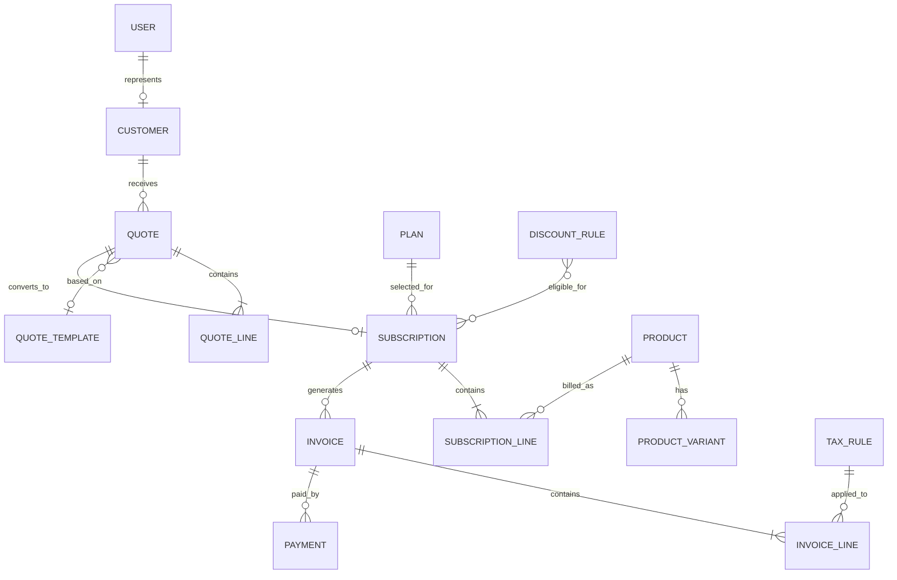

# Subscription Management System - Architecture

**Status:** Draft for hackathon implementation
**Source:** `docs/Subscription_Management_System.pdf`
**Team:** Srinanth, Angelo, Deepak

See [API.md](API.md) for endpoint contracts, [FEATURE_TRACKER.md](FEATURE_TRACKER.md) for ownership and progress, and [adr/](adr/) for accepted architecture decisions.

## 1. Architecture direction

Use a **modular monolith**: one web application, one API/backend, and one relational database, with clear domain modules. This is a good fit for a short hackathon because the team can work in parallel without operating multiple services or distributed transactions. Keep module boundaries explicit so domains can be split later if needed.

The brief does not prescribe a technology stack. The design below is technology-neutral; agree on the stack before implementation and preserve the entities, boundaries, and behaviors in this document.

## 2. System context

## 3. Module ownership and work split

The split assigns related features together and gives each person an end-to-end domain with user-visible work, business logic, persistence, and integration responsibilities. It is a proposed ownership plan; agree as a team before implementation.

### Srinanth - Catalog, configuration, and access foundation

- Product catalog, product types, variants, and configurable variant price adjustments.
- Subscription plan configuration: price, billing interval, minimum quantity, availability, and end/pause/renew policy.
- Tax rules and discount rule authoring/validation (including applicability, minimums, dates, and usage limits).
- Authentication, account uniqueness, password policy/reset flow, role and permission model, admin-only staff creation.
- Shared application shell/navigation and access-control middleware or policy layer.
- Owns shared domain conventions: IDs, currency/decimal conventions, roles, and validation/error response shape.

**Deliverable:** Admin can configure the catalog, plans, tax/discount rules, and user access; common identity and authorization are usable by the other modules.

### Angelo - Customer, quotation, subscription lifecycle, and portal

- Customer profiles and customer account registration/association.
- Quotation templates, quote editing, expiry, line items, and quote-to-subscription conversion.
- Subscription lifecycle and valid transitions: Draft, Quotation, Confirmed, Active, Paused, Closed; renewal and early/end-date closure behavior.
- Customer portal for viewing and managing only the authenticated customer's own subscriptions and invoices (invoice view supplied by the billing module).
- Subscription detail and operational views for staff, including next billing date and current state.
- Integration with catalog pricing, tax/discount eligibility, and billing's subscription contract.

**Deliverable:** Staff can create a quote and convert it to an active, traceable subscription; customers can securely inspect their own subscription information.

### Deepak - Recurring billing, invoices, payments, and finance reporting

- Billing schedule/run logic, due-subscription selection, invoice creation, retry safety, and run outcomes.
- Invoice calculation from subscription lines, taxes and eligible discounts; invoice state/action flow (Draft, Confirmed, Paid; cancel/send/print).
- Email/PDF adapter for invoice delivery/rendering, using a demo-safe provider configuration.
- Payment records linked to invoices, balance/status calculation, and overdue identification.
- Finance dashboard and filtered reports for active subscriptions, collected revenue, outstanding amounts, payments, and overdue invoices.
- Performance work for report queries and indexes against the stated thousands-of-subscriptions target.

**Deliverable:** A due subscription produces one correct invoice per period; staff can track payments and finance can see collection health.

### Shared work and seams

- All three agree on the entity contracts and workflow states in section 4 before parallel implementation.
- Each owner implements their module's UI/API/data logic and contributes a vertical slice to integration.
- Srinanth reviews access-control integration; Angelo reviews subscription lifecycle integration; Deepak reviews invoice/payment calculation integration.
- One shared demo seed dataset and one end-to-end walkthrough are maintained by the team together.
- No domain is only documentation or glue work; each owner has core business logic and a demo-visible feature area.

## 4. Domain model

### Core records and constraints

| Record | Key fields / constraints |
|---|---|
| User | email unique; password hash; role (`admin`, `staff`, `customer`); customer association for portal users |
| Customer | contact details; optional linked user; customer data is the ownership boundary for portal access |
| Product / Variant | name, type, sales price, cost price, notes; variant price adjustment stored as explicit amount/rule |
| Plan | billing interval, price, minimum quantity, availability dates, close/pause/renew policy |
| TaxRule | name, rate, active period/status; calculation behavior documented and versioned on invoice lines |
| DiscountRule | fixed/percentage value, date window, minimum, usage limit/count, product or subscription scope |
| Quote / QuoteLine | unique quote number, customer, validity dates, state, payment terms, line quantity/price/tax/amount |
| Subscription / SubscriptionLine | unique subscription number, customer, plan, dates, state, billing anchor/next due date, terms and lines |
| Invoice / InvoiceLine | unique invoice number; subscription and billing period; amounts, currency, state, due date; snapshot of prices/taxes/discounts |
| Payment | invoice, method, amount, date, note; amount is positive and does not exceed allowed balance unless overpayment behavior is explicitly supported |
| BillingRun | run timestamp/date, status, counts, error summary; supports operational visibility and safe retry |

Financial records should snapshot applied unit prices, tax rates, discount values, currency, and customer billing details so later catalog edits do not rewrite history. Use fixed-precision decimal amounts.

## 5. Main runtime flows

### Quote and subscription

1. Staff chooses a customer and quote template.
2. Sales module requests product/plan pricing and relevant tax/discount rules from catalog/configuration.
3. Quote saves a price snapshot, validity date, payment terms, and lines.
4. On confirmation, the quote converts once into a subscription; the subscription receives its billing interval, period anchor, next due date, and lifecycle state.
5. A state-transition service validates every transition and records who performed it and when.

### Recurring billing

1. Scheduler (or staff-triggered action for the demo) starts a billing run for a business date.
2. Billing selects eligible active subscriptions whose `next_billing_at` is due and which are not closed/paused.
3. For each subscription, a database transaction claims the subscription-period key, snapshots invoice lines, applies eligible discount/tax rules, creates one invoice, and advances `next_billing_at`.
4. A unique constraint on `(subscription_id, billing_period_start)` prevents duplicates under retries or concurrent workers.
5. Failures are recorded per subscription; retrying processes failed/unprocessed periods without creating duplicates or advancing dates prematurely.

### Payments and reporting

Payment records are appended against an invoice. The outstanding balance is derived from invoice total minus successful payment amounts; status is derived from balance and due date (with cancellation handled explicitly). Reports aggregate from invoice, payment, and subscription records, using documented definitions and date filters.

## 6. API boundary suggestions

These are logical endpoints, not a required framework-specific route format.

| Area | Operations |
|---|---|
| Identity | register customer, sign in, request/reset password, invite/create staff (admin only), current-user/role |
| Catalog/configuration | CRUD products/variants/plans/tax rules/discount rules; validate pricing and rule eligibility |
| Customers | search/create/update customer; staff-only operational access |
| Quotes | CRUD templates and quotes; calculate preview; send; confirm/convert |
| Subscriptions | list/detail; transition state; renew/pause/close; customer-scoped list/detail |
| Billing/invoices | run billing for date; inspect run; list/detail invoice; confirm/cancel/send/print; customer-scoped invoice list/detail |
| Payments | record payment; list invoice payments; recalculate balance/status |
| Finance reports | summary and filtered series/tables for subscriptions, revenue, payments, balances, overdue invoices |

Use consistent server-side authorization for every operation. Customer-scoped endpoints should derive customer identity from the authenticated session rather than accepting an arbitrary customer ID as authority.

## 7. Data, security, and operational decisions

- **Database:** Relational database with foreign keys and transactions. Add indexes on `subscription.state`, `subscription.next_billing_at`, invoice due date/state, customer IDs, and report date fields.
- **Billing safety:** Enforce uniqueness per subscription billing period; use transactions/row-level claiming or equivalent; persist a BillingRun record and structured errors.
- **Authorization:** Deny by default. Admin has full configuration; staff has operational permissions; customer access is ownership-scoped. Only admin may create staff accounts.
- **Authentication:** Unique normalized email, secure password hashes, expiring single-use reset tokens, and the specified password policy.
- **External services:** Hide mail and PDF generation behind adapters. Manual payment recording is in scope; payment gateways are not required by the brief.
- **Auditability:** Track state changes, invoice actions, discount consumption, and payment creation with actor and timestamp; do not silently mutate issued invoice snapshots.
- **Reporting:** Define revenue as collected payments in the selected period for the MVP; display invoiced and outstanding amounts as separate metrics. Use database aggregation rather than loading every row into application memory.

## 8. Suggested integration sequence

1. Agree on stack, currency/timezone, entity IDs, money representation, and lifecycle enums.
2. Create application shell, database schema, auth/roles, and seed/demo data.
3. Integrate catalog/plan pricing with quote and subscription creation.
4. Integrate subscription state and next-billing-date contract with recurring billing.
5. Complete invoice calculation and payment tracking; verify the invoice-per-period uniqueness rule.
6. Add portal ownership checks and finance reports.
7. Rehearse the acceptance flow in the PRD using a seeded customer, a variant, a discount, and a due subscription.

## 9. Decisions to confirm as a team

- Chosen stack and whether the project is a standalone application or an Odoo module.
- Single currency and business timezone for the demo.
- Whether to implement invoice PDF/email delivery or show an in-app simulated send.
- Whether discounts are consumed on invoice creation or invoice confirmation; recommended: consume atomically when an invoice is confirmed.
- Whether subscription cancellation takes effect immediately or at period end; support both if time permits and make the effective date visible.
