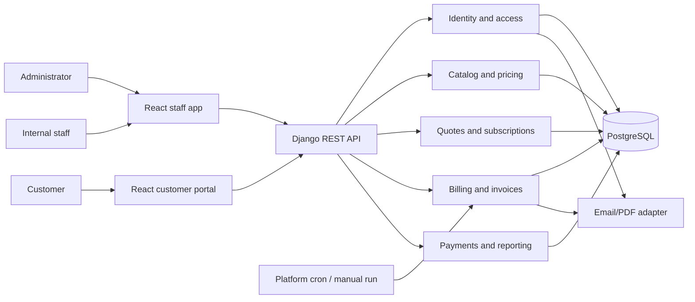

# Subscription Management System - Architecture

**Status:** Draft for hackathon implementation
**Source:** `docs/Subscription_Management_System.pdf`
**Team:** Srinanth, Angelo, Deepak

See [API.md](API.md) for endpoint contracts, [FEATURE_TRACKER.md](FEATURE_TRACKER.md) for full-stack ownership and progress, [adr/](adr/) for accepted architecture decisions, and [../db/](../db/) for the schema reference and ER diagram.

## 1. Architecture direction

Use a **modular monolith**: one React web client, one Django API/backend, and one PostgreSQL database, with clear domain modules. This fits the short hackathon schedule while keeping billing, subscription changes, and invoice creation inside reliable database transactions. Keep module boundaries explicit so domains can scale independently later if needed.

### Selected stack

| Layer | Choice | Why it fits this project |
|---|---|---|
| Backend | Python 3.13, Django 5.2 LTS, Django REST Framework | Django supplies authentication, ORM, migrations, security protections, and a useful admin for configuration/debugging. DRF provides serializers, permissions, pagination, and the JSON API already described in `API.md`. Django 5.2 is the current LTS line with security support through April 2028. |
| Frontend | React + TypeScript + Vite + Tailwind CSS | Component-based staff workflows and a polished finance dashboard/customer portal; type checking helps three people work against shared API contracts. Tailwind generates static CSS at build time, and Vite builds assets that can be served from the same application origin. |
| Database | PostgreSQL 18 with Psycopg 3 | Relational constraints and transactions protect invoice/subscription integrity; indexes and SQL aggregation support the reporting workload. PostgreSQL 18 is currently supported through November 2030. |
| Local development | Docker Compose for Django and PostgreSQL; Node package manager for the Vite client | Gives all three contributors the same database and startup path without requiring paid infrastructure. |
| Production/demo | Gunicorn + Django/DRF + WhiteNoise in one web service; one small managed PostgreSQL database | Keeps service count and deployment cost low; WhiteNoise serves the built React/static assets, and one origin simplifies session authentication and CSRF. Use the smallest reliable paid database/web tier available to the team and scale only when measured demand requires it. |

Use the latest patch release in the selected supported series and commit dependency lock files. The PDF does not require an Odoo module or name Odoo as an implementation platform; this decision is for a standalone application. If the organizers later require an Odoo module, revisit ADR-004 before coding.

### Runtime and deployment shape

- The React app calls the versioned Django REST API on the same origin. Django serves the built SPA entry point and WhiteNoise serves collected, fingerprinted static assets; in development, Vite proxies `/api` to Django.
- Use Django session authentication with secure, HTTP-only cookies and CSRF protection. Avoid a separately hosted frontend and long-lived browser tokens in the MVP.
- Run recurring billing as an idempotent Django management command, triggered manually for the demo and by one platform cron job when scheduled runs are needed. Do not add Celery, Redis, or a separate worker until real asynchronous workload justifies the added service and operations.
- Use PostgreSQL as the source of truth for billing, payment, and subscription state. A billing run claims a subscription-period row/unique key and creates its invoice plus next due date in one transaction.
- Use PostgreSQL aggregation, pagination, and indexes for finance reports. Add a cache only after profiling shows a repeated expensive query; the specified volume is thousands of subscriptions.
- Deploy one web replica initially. The web process remains stateless apart from PostgreSQL-backed state, so more replicas can be added behind a load balancer when demand grows. Keep uploads/object storage out of the MVP unless a real requirement appears.

## 2. System context

## 3. Module ownership and work split

The split assigns related features together and gives each person an end-to-end domain with user-visible work, business logic, persistence, and integration responsibilities. It is a proposed ownership plan; agree as a team before implementation.

### Srinanth - Platform foundation, catalog, configuration, and access

- **Backend (`backend/`):** Django project configuration; custom user/auth/roles/password reset; admin-created staff; product/variant pricing; plans; tax and discount configuration/eligibility; shared permission and error conventions.
- **Frontend (`frontend/`):** Application shell, navigation, login/register/reset screens, role-aware layout, and catalog/variant/plan/tax/discount setup screens.
- Owns the shared API/client conventions, ID/currency rules, and `db/` schema-reference coordination.

**Deliverable:** A working application foundation and staff setup journey; the other domains can rely on shared auth, pricing, and access contracts.

### Angelo - Customer, quotation, subscription lifecycle, and portal

- **Backend (`backend/`):** Customer records/account association; quotation templates/quotes; quote pricing snapshot and conversion; subscription model, state transitions, renewal/pause/closure, next billing date; customer ownership-scoped APIs.
- **Frontend (`frontend/`):** Customer management; quotation template and quote editor; quote-to-subscription screens; staff subscription list/detail/actions; customer portal for own subscriptions and invoices (invoice data supplied by Deepak).
- Integrates with Srinanth's catalog/auth APIs and Deepak's billing subscription contract.

**Deliverable:** Staff can complete quote-to-active-subscription; customers can securely use their portal.

### Deepak - Recurring billing, invoices, payments, and finance reporting

- **Backend (`backend/`):** Billing run/management command; due-subscription selection and idempotency; invoice/tax/discount snapshots and state actions; payment records/balance/overdue logic; finance aggregation APIs; query/index work.
- **Frontend (`frontend/`):** Billing run control and status/errors; invoice list/detail/actions/print view; payment recording; finance summary cards, filters, overdue queue, and charts/tables.
- Integrates with Angelo's subscription contract and Srinanth's tax/discount/auth policies.

**Deliverable:** Staff can run/inspect billing, send or print correct invoices, record payments, and review collections.

### Shared work and seams

- Keep `frontend/`, `backend/`, and `db/` separate; each owner delivers a full-stack slice by changing only their domain's frontend and backend modules plus the shared contracts they own.
- Django models and migrations are the executable schema source of truth. Update `db/schema.sql` and `db/schema.mmd` in the same feature when persisted entities or relationships change.
- All three agree on entity contracts and workflow states in section 4 before parallel implementation.
- Each owner implements both UI and API/data logic for their feature and contributes a vertical slice to integration.
- Srinanth reviews access-control integration; Angelo reviews subscription lifecycle integration; Deepak reviews invoice/payment calculation integration.
- One shared demo seed dataset and one end-to-end walkthrough are maintained by the team together.
- No domain is only documentation or glue work; each owner has core business logic and a demo-visible feature area.

## 4. Domain model

The complete ER diagram is maintained once in [`db/schema.mmd`](../db/schema.mmd); its PostgreSQL table and constraint reference is [`db/schema.sql`](../db/schema.sql).

### Core records and constraints

| Record | Key fields / constraints |
|---|---|
| BusinessProfile | Single company profile; default currency and IANA timezone |
| User | email unique; password hash; role (`admin`, `staff`, `customer`); customer association for portal users |
| Customer | contact details; optional linked user; customer data is the ownership boundary for portal access |
| Product / Variant | name, type, sales price, cost price, notes; variant price adjustment stored as explicit amount/rule |
| Plan | billing interval, price, minimum quantity, availability dates, close/pause/renew policy |
| TaxRule | name, rate, active period/status; calculation behavior documented and versioned on invoice lines |
| DiscountRule / Redemption | fixed/percentage value, date window, minimum, usage limit, product/subscription scope; reserved/consumed/released usage |
| QuoteTemplate / QuoteTemplateLine | reusable validity/payment terms and default product/plan lines |
| Quote / QuoteLine / QuoteLineTax | unique quote number, customer, validity, state, payment terms, priced lines, tax snapshots |
| Subscription / SubscriptionLine | unique subscription number, customer, plan, dates, state, billing anchor/next due date, terms and lines |
| SubscriptionEvent | transition/action history with actor, time, prior/new state, and note |
| BillingRun / BillingRunItem | business date, status, counts, per-subscription result/error; supports retries and operations visibility |
| Invoice / InvoiceLine / InvoiceLineTax / InvoiceDiscountLine | unique invoice number and subscription-period pair; due date/state; price, tax, discount, customer, and currency snapshots |
| Payment | invoice, method, amount, date, note; amount is positive and does not exceed allowed balance unless overpayment behavior is explicitly supported |
| PasswordResetToken / AuditEvent | hashed single-use reset token with expiry; actor/action/entity audit trail |

Financial records should snapshot applied unit prices, tax rates, discount values, currency, and customer billing details so later catalog edits do not rewrite history. Use fixed-precision decimal amounts.

## 5. Main runtime flows

### Quote and subscription

1. Staff chooses a customer and quote template.
2. Sales module requests product/plan pricing and relevant tax/discount rules from catalog/configuration.
3. Quote saves a price snapshot, validity date, payment terms, and lines.
4. On confirmation, the quote converts once into a subscription; the subscription receives its billing interval, period anchor, next due date, and lifecycle state.
5. A state-transition service validates every transition and records who performed it and when.

### Recurring billing

1. Scheduler (or staff-triggered action for the demo) starts a billing run for a business date.
2. Billing selects eligible active subscriptions whose `next_billing_at` is due and which are not closed/paused.
3. For each subscription, a database transaction claims the subscription-period key, snapshots invoice lines, applies eligible discount/tax rules, creates one invoice, and advances `next_billing_at`.
4. A unique constraint on `(subscription_id, billing_period_start)` prevents duplicates under retries or concurrent workers.
5. Failures are recorded per subscription; retrying processes failed/unprocessed periods without creating duplicates or advancing dates prematurely.

### Payments and reporting

Payment records are appended against an invoice. The outstanding balance is derived from invoice total minus successful payment amounts; status is derived from balance and due date (with cancellation handled explicitly). Reports aggregate from invoice, payment, and subscription records, using documented definitions and date filters.

## 6. API boundary suggestions

These are logical endpoints, not a required framework-specific route format.

| Area | Operations |
|---|---|
| Identity | register customer, sign in, request/reset password, invite/create staff (admin only), current-user/role |
| Catalog/configuration | CRUD products/variants/plans/tax rules/discount rules; validate pricing and rule eligibility |
| Customers | search/create/update customer; staff-only operational access |
| Quotes | CRUD templates and quotes; calculate preview; send; confirm/convert |
| Subscriptions | list/detail; transition state; renew/pause/close; customer-scoped list/detail |
| Billing/invoices | run billing for date; inspect run; list/detail invoice; confirm/cancel/send/print; customer-scoped invoice list/detail |
| Payments | record payment; list invoice payments; recalculate balance/status |
| Finance reports | summary and filtered series/tables for subscriptions, revenue, payments, balances, overdue invoices |

Use consistent server-side authorization for every operation. Customer-scoped endpoints should derive customer identity from the authenticated session rather than accepting an arbitrary customer ID as authority.

## 7. Data, security, and operational decisions

- **Database:** Relational database with foreign keys and transactions. Add indexes on `subscription.state`, `subscription.next_billing_at`, invoice due date/state, customer IDs, and report date fields.
- **Billing safety:** Enforce uniqueness per subscription billing period; use transactions/row-level claiming or equivalent; persist a BillingRun record and structured errors.
- **Authorization:** Deny by default. Admin has full configuration; staff has operational permissions; customer access is ownership-scoped. Only admin may create staff accounts.
- **Authentication:** Unique normalized email, secure password hashes, expiring single-use reset tokens, and the specified password policy.
- **External services:** Hide mail and PDF generation behind adapters. Manual payment recording is in scope; payment gateways are not required by the brief.
- **Auditability:** Track state changes, invoice actions, discount consumption, and payment creation with actor and timestamp; do not silently mutate issued invoice snapshots.
- **Reporting:** Define revenue as collected payments in the selected period for the MVP; display invoiced and outstanding amounts as separate metrics. Use database aggregation rather than loading every row into application memory.

## 8. Suggested integration sequence

1. Set up Python/Django/DRF, React/Vite, PostgreSQL, Docker Compose, and the shared currency/timezone, IDs, money representation, and lifecycle enums.
2. Create application shell, database schema, auth/roles, and seed/demo data.
3. Integrate catalog/plan pricing with quote and subscription creation.
4. Integrate subscription state and next-billing-date contract with recurring billing.
5. Complete invoice calculation and payment tracking; verify the invoice-per-period uniqueness rule.
6. Add portal ownership checks and finance reports.
7. Rehearse the acceptance flow in the PRD using a seeded customer, a variant, a discount, and a due subscription.

## 9. Decisions to confirm as a team

- Single currency and business timezone for the demo.
- Whether to implement invoice PDF/email delivery or show an in-app simulated send.
- Whether discounts are consumed on invoice creation or invoice confirmation; recommended: consume atomically when an invoice is confirmed.
- Whether subscription cancellation takes effect immediately or at period end; support both if time permits and make the effective date visible.

The stack choice and standalone-app direction are recorded in [ADR-004](adr/ADR-004-selected-mvp-stack.md).
